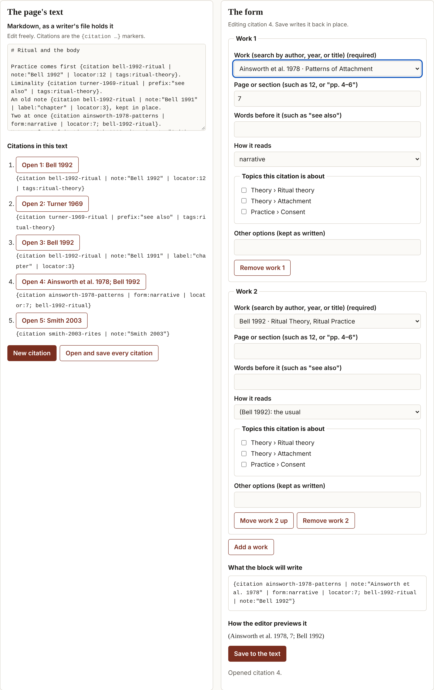

# draft.inator

Writing tools for sites whose content lives in a git repository and is edited in a browser.
draft.inator adds the blocks writers expect from WordPress or Joomla (citations, figures, tables, embeds,
callouts, links) to [Sveltia CMS](https://github.com/sveltia/sveltia-cms), with
[citation.inator](https://github.com/randal-cox/citation.inator) built in for scholarly citation.

> "Behold, my draft.inator! Now the entire Tri-State Area will have to address my reviewer comments!" (Theandra)

**Status: 0.1.0.** One block works: **Cite**. It was built inside korazonresearch.org (Korazon Research), where it
reads and writes every one of that site's 163 citation markers without changing what readers see. This repository is
where it becomes a plug-in any site can use.

## See it working

**[Live demos](https://randal-cox.github.io/draft.inator/demo/)**: the Cite block and the build tools, running in your
browser. To run them locally, serve the repository (`python3 -m http.server`) and open `/demo/`.



**[Documentation](docs/README.md)**: [for writers](docs/writers.md), [getting started](docs/getting-started.md),
[the build tools](docs/tools.md), and [how draft.inator and citation.inator fit together](docs/citation-inator.md).

## What's here

| Path | What |
|---|---|
| `src/blocks/citation.js` | The Cite block: a Sveltia editor component that reads and writes citation.inator markers |
| `src/blocks/figure.js` | The Figure block: an image with alt text, caption, provenance, and placement (0.3) |
| `demo/` | Live demos (GitHub Pages): the Cite block in a stand-in editor, and the build tools on a sample site |
| `examples/sample-site/` | A small site the tests, demos, and docs all use |
| `tools/` | Build tools: keep notes current, total tags, write `works.js` (`docs/tools.md`) |
| `vendor/citation-inator/` | citation.inator's tools bundle, vendored so nothing needs installing |
| `test/` | `npm test` (Node 22, no dependencies): round-trip, quoting, option order, preview, the tools, and agreement with citation.inator |
| `docs/prd.md` | **The product requirements**: who it's for, what it does, what it won't do |
| `docs/roadmap.md` | Milestones, in order |
| `docs/tools.md` | The build tools, step by step |
| `docs/data-contract.md` | What a host site provides (the works list, the topics) and what the blocks write |
| `docs/origin.md` | Where each piece came from in korazonresearch.org, and what is still site-specific |
| `docs/import-sketch.md` | Feasibility sketch: turning pasted APA/Chicago citations into markers |
| `examples/sveltia/` | How a site loads the blocks |

## Try it

```bash
npm test
```

## Using it in a site (today)

See `examples/sveltia/index.html`. In short: load Sveltia, then a `works.js` your build writes
(`window.DRAFT_WORKS`, `window.DRAFT_TOPICS`; see `docs/data-contract.md`), then `src/blocks/citation.js`.

## Licence

MIT (see `LICENSE`), as citation.inator. Changes are listed in `CHANGELOG.md`.

## Related

- citation.inator (Theandra): the citation compiler and query API the Cite block depends on.
- korazonresearch.org: the first host site, and the source of this code.
