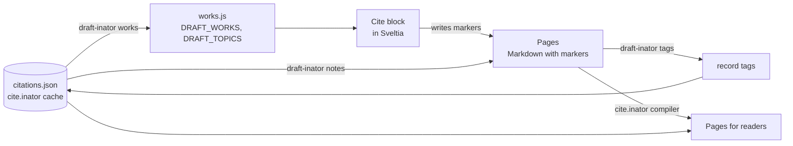

# draft.inator and cite.inator

[cite.inator](https://github.com/randal-cox/cite.inator) (formerly citation.inator) is the citation library: it reads citation markers in
a page, looks works up, formats citations and endnotes, and shows readers a panel about each source. draft.inator is
the writing side: it gives writers a form for those markers, and keeps the markers tidy across a whole site.

draft.inator never formats a citation for readers. cite.inator does that, in the site's build.

## Who does what

| Job | draft.inator | cite.inator |
|---|---|---|
| The marker grammar (`{cite id \| locator:12}`) | Writes it | Defines it, reads it |
| A form for writers | **Cite block** | |
| Citations, endnotes, and reading lists readers see | | Compiler |
| A work's short description ("Bell 1992") | Shows it | `describeCitation` |
| Notes in markers kept current | `draft-inator notes` (runs it over a site) | `annotateMarkers` |
| Tag totals per work | `draft-inator tags` (adds curation) | `collectMarkerTags` |
| The editor's list of works | `draft-inator works` | `describeCitation` over the cache |
| Looking works up (Crossref, Open Library) | | Its resolvers |
| Which markers are citations and which are directives | Follows it; tested against it | Defines it: `markerKind` |

## How data moves

1. The site's build keeps a cite.inator cache: one record per work.
2. `draft-inator works` turns the cache into `works.js`, which the Cite block reads in the editor.
3. Writers cite works; the block writes markers into the page files, each with a `note:`.
4. In each pull request, `draft-inator notes` checks every note against the cache, so a changed record never leaves
   a misleading note behind.
5. `draft-inator tags` totals the topics writers gave each work; curators adjust them; they become the records' tags.
6. The site's build compiles the pages with cite.inator for readers.

## Versions

draft.inator vendors cite.inator's tools bundle (`vendor/citation-inator/`, currently 0.3.0), so its tools and
tests need nothing installed. The site's own build uses whatever cite.inator version it takes; keep the two on the
same version, and the same citation style, so notes agree with what readers see.

## What draft.inator has asked of cite.inator

Requests are kept in [`docs/requests/`](requests/). Both from 21 Nov 2026 were delivered the same day, and released in
cite.inator 0.3.0 (#7, #8):

- `markerKind`, cite.inator's own test of "citation or directive". The Cite block still needs a regular
  expression (Sveltia finds blocks with one), so `markerKind` is what the tests hold that expression to.
- `annotateMarkers(…, { noteContext: "work" })`: notes without year letters, so the build and the editor agree.

## Larger plug-ins

Small blocks (Cite, Figure, Table, Embed, Callout, Links) stay in draft.inator. A larger piece, such as citation
import, may become its own project. If it does, it talks to draft.inator only through the
[data contract](data-contract.md), as a host site does.
