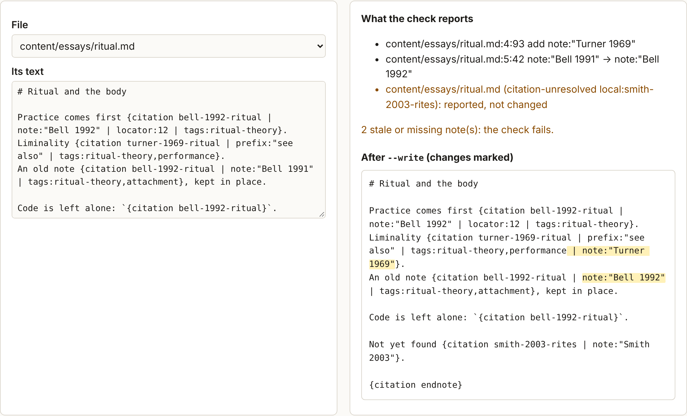

# Build tools: notes, tags, and works

The Cite block runs in the writer's browser. Three jobs need the whole site instead, so they run in the site's build
(or by hand, or in a pull-request check):

| Command | What it does | When to run it |
|---|---|---|
| `draft-inator notes` | Checks that every marker's `note:` is citation.inator's current description of the work | In every pull request (fails on a stale note); `--write` to fix |
| `draft-inator tags` | Totals the topics writers gave each work while citing it, plus a curator's additions and blocks | When you rebuild the citation records |
| `draft-inator works` | Writes `works.js`, the list of works the Cite block offers (`docs/data-contract.md`) | Whenever the citation cache changes; `--check` in pull requests |

All three need Node 22 and nothing else: citation.inator's tools are vendored in `vendor/citation-inator/`.

## Before you start

You need two things from your site:

1. **A citation.inator cache**: the `citations.json` your site's build gives citation.inator (schema
   `citation-inator.cache.v1`). Every work a writer can cite is a record in it.
2. **Your content folders**: wherever your Markdown or HTML pages live. The tools read `.md`, `.markdown`, `.html`,
   `.htm`, and `.txt` files, skipping hidden folders and `node_modules`.

## Settings

The tools must use the **same citation style as your site's build**, or the notes they write won't match what the
editor writes. Put the settings in one file, `draft-inator.json`, next to your content:

```json
{
  "cache": "data/citations.json",
  "style": "chicago-author-date",
  "content": ["content"],
  "topics": "data/topics.json",
  "curation": "data/tag-curation.json",
  "works": "admin/draft-inator/works.js"
}
```

| Setting | Meaning |
|---|---|
| `cache` | The citation.inator cache |
| `style` | citation.inator's `citationStyle` (`default`, `apa`, `chicago-author-date`, `mla`, …). Use your build's |
| `keyword` | citation.inator's `citationKeyword`, if your site changed it from `citation` |
| `noteContext` | `work` (the default): notes describe the work alone, as the editor does. `article`: notes include year letters ("Cox 1995a"); only for sites that don't use the Cite block |
| `content` | Folders (or files) to read |
| `topics` | Optional: the topics a citation can be tagged with, `[{ "id": "…", "label": "…" }]` |
| `curation` | Optional: per-work tag additions and blocks (below) |
| `works` | Where `works.js` goes |

Paths are relative to the settings file. Any setting can be given as a flag instead (`--cache`, `--style`, …), and
content folders as plain arguments; flags win over the file. The name and format of the site file are still open
(`docs/prd.md`, "One site file"); this JSON file may grow into it.

## Keep notes current: `draft-inator notes`



Try it in the [build tools demo](https://randal-cox.github.io/draft.inator/demo/tools.html).

```sh
npx draft-inator notes --config draft-inator.json
```

```
content/essays/ritual.md:4:93  add note:"Turner 1969"
content/essays/ritual.md:5:42  note:"Bell 1991" → note:"Bell 1992"
content/essays/ritual.md  (citation-unresolved local:smith-2003-rites)
2 stale or missing note(s). Run with --write to refresh them.
```

It exits with 1 when a note is stale or missing, so it can fail a pull request. With `--write` it saves the refreshed
files. It uses citation.inator's `annotateMarkers`, which:

- changes only `note:` options; every other byte of the file is kept;
- leaves code, links, and raw HTML in Markdown alone;
- leaves a citation of an unresolved work as it is and reports it (shown in parentheses). Those don't fail the check
  unless you add `--strict`.

A second `--write` changes nothing.

## Tag totals: `draft-inator tags`

When a writer tags a citation (`{citation bell-1992-ritual | tags:ritual-theory}`), that's one vote that the work is
about ritual theory. `tags` counts the votes per work and lets a curator overrule them:

```json
{
  "bell-1992-ritual": { "add": ["consent"], "block": ["attachment"] }
}
```

```sh
npx draft-inator tags --config draft-inator.json --out data/record-tags.json
```

`--out` writes `{ "<work id>": ["tag", …] }`, ready to become each record's `tags` in citation.inator. Without
`--out` it prints the full report: counts, what was added, and what was blocked. Anything a person should look at
(a tag that isn't one of your topics, curation for a work nobody has tagged, a work missing from the cache) is printed
as a `note:`. Nothing is dropped without one.

## The works list: `draft-inator works`

```sh
npx draft-inator works --config draft-inator.json
```

Writes `works.js` with `window.DRAFT_WORKS` (every record: its id, its note in your style, its title and year) and,
if you gave topics, `window.DRAFT_TOPICS`. One work per line, sorted by note, so a changed record is a one-line diff.

Works citation.inator can't describe yet still need a note, so an existing marker never opens with a blank. They get
the record's `citationText`, else its `original` text, else its id, and each is printed as a `note:`.

`--check` compares instead of writing, and exits with 1 if the file is out of date.

## In a pull-request check

```yaml
- run: npx draft-inator works --config draft-inator.json --check
- run: npx draft-inator notes --config draft-inator.json
```

## From JavaScript

Each command is a plain function: `checkNotes(settings, { write })` in `tools/notes.js`, `totalTags(settings)` in
`tools/tags.js`, `buildWorks(settings)` and `worksJs({ works, topics })` in `tools/works.js`. `settings` is the same
object as the file, with `cache` either a path or the cache itself.

`tools/core.js` holds the parts that need no file system (`noteEdits`, `tagTotals`, `worksFromCache`, `worksJs`).
It runs in a browser as well as Node; the live demos use it, so they show exactly what the commands do.

## Year letters

When one article cites two works by the same author in the same year, readers see them told apart with letters
("Cox 1995a", "Cox 1995b"); citation.inator's compiler does that. Notes don't carry the letters: they describe each
work alone ("Cox 1995"), exactly as `works.js` and the Cite block do, so saving in the editor never makes the check
fail. (This uses citation.inator's `noteContext: "work"`. Set `"noteContext": "article"` to get lettered notes, but
only if you don't use the Cite block.)
