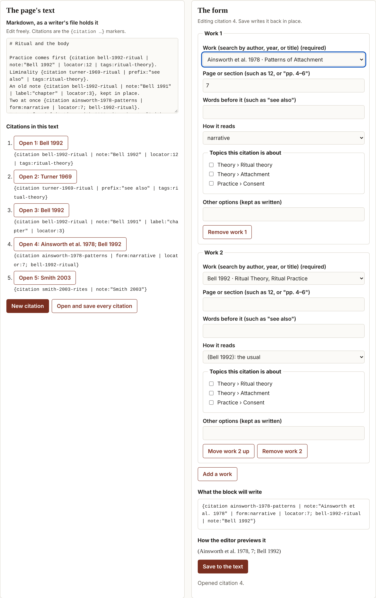

# Citing a work

For writers using a site's editor (Sveltia CMS) with draft.inator's Cite block. You don't need to know any markup.
To try it without a site, use the [Cite block demo](https://randal-cox.github.io/draft.inator/demo/cite.html).



## Add a citation

1. Put the cursor where the citation belongs, usually just before the full stop.
2. In the editor, insert a **Citation** block. It is offered alongside the editor's other blocks, such as images.
3. Under **Works cited here**, choose the work. The list shows each work's short form and title, such as
   "Bell 1992 · Ritual Theory, Ritual Practice". Type part of an author's name, a year, or a title to narrow it.
4. Fill in what you need, and leave the rest empty:
   - **Page or section**: `12`, or `pp. 4–6`.
   - **Words before it**: `see also`, `cf.`.
   - **How it reads**: leave it as "the usual" for "(Bell 1992)". "narrative" gives "Bell (1992)" for a sentence
     that names the author.
   - **Topics this citation is about**: tick any that fit. Each tick is a vote for what the work is about; the site's
     curators see the totals.
5. To cite several works at once, such as "(Bell 1992; Turner 1969)", choose **Add a work** and fill in the next one.
6. Save the block.

The editor shows the citation as it will read, "(Bell 1992, 12)". The page's file holds a short marker instead:

```
{citation bell-1992-ritual | note:"Bell 1992" | locator:12}
```

You never need to type one, but you can read it. `note:` is there so anyone reading the file can tell what it cites.

## Change a citation

Open the citation block in the editor. Everything it holds appears in the form; change what you need and save.

- **Nothing you didn't touch changes.** Opening and saving a citation keeps everything as it was, except that its
  note is brought up to date.
- **Other options (kept as written)** holds anything the form doesn't have a field for, such as a custom label. Leave
  it alone unless someone has asked you to change it.

## If something looks wrong

| You see | It means | What to do |
|---|---|---|
| The work isn't in the list | It isn't in the site's references yet | Ask a curator to add it, or add it yourself if your site lets writers add works |
| A work shows its in-text wording instead of a title | The site hasn't found the full reference yet | Nothing; cite it as usual. It will fill in when the reference is found |
| A pull request check says a note is stale | A work's details changed after you cited it | A maintainer runs the notes tool to refresh it; your text is unaffected |
| `{citation endnote}` or `{citation list …}` in a page | These place the endnotes or a reading list | Leave them; they aren't citations and can't be opened in the form |
